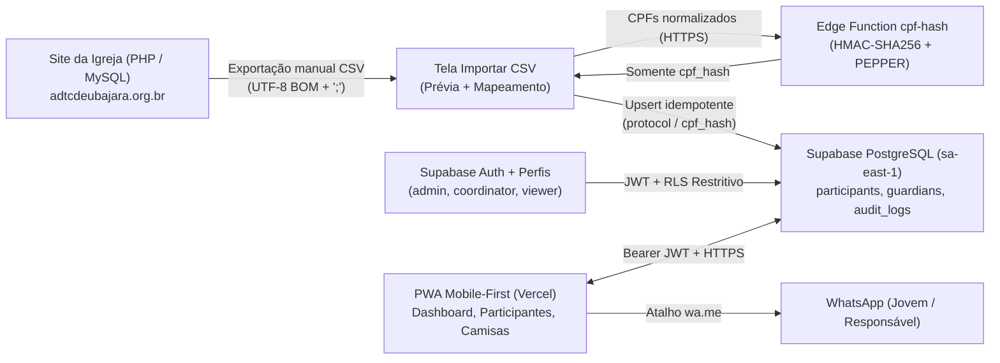
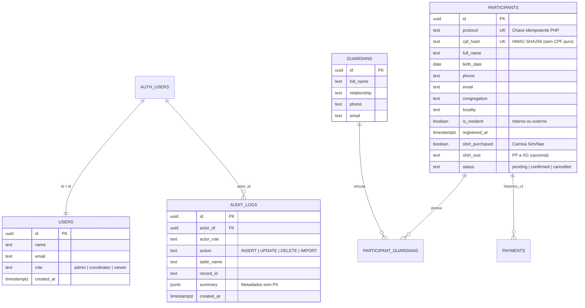
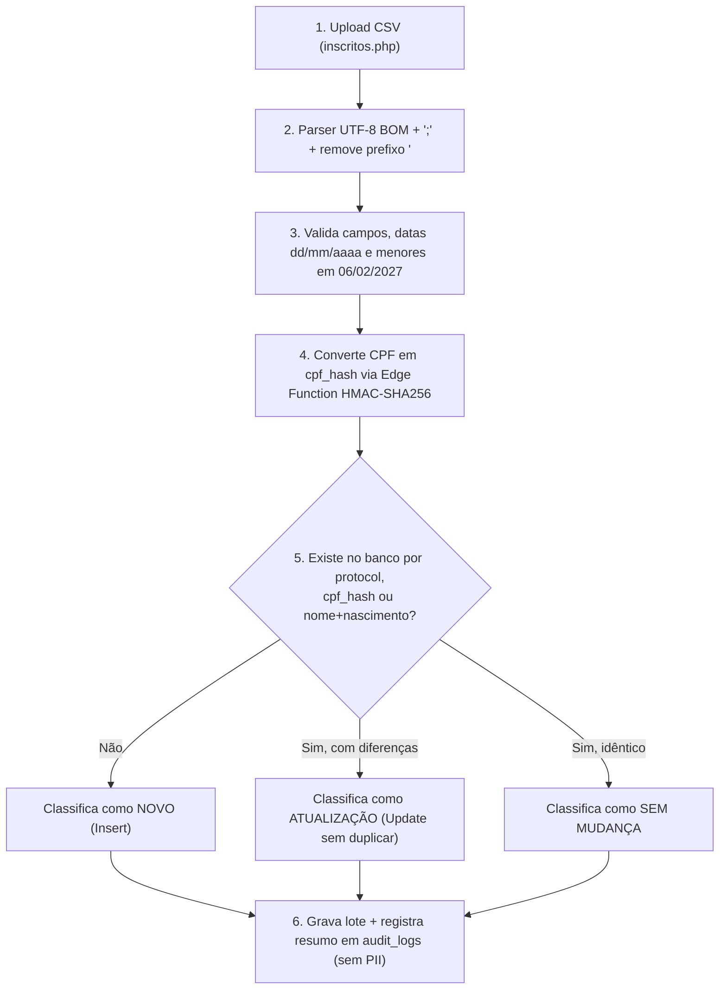
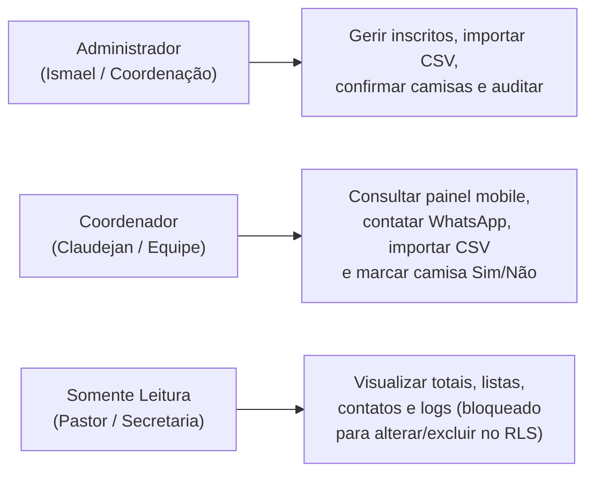

# Arquitetura e Modelagem — Retiro de Jovens 2027 (AE IV)

Este documento descreve a arquitetura técnica adotada na **Atividade Extensionista IV (UNINTER)** para a **ADTC Templo Central de Ubajara/CE**, integrando o painel gerencial em React/Supabase ao sistema de inscrições PHP já existente na igreja.

---

## 1. Arquitetura Geral do Sistema (Opção A)

Optou-se por manter e evoluir o aplicativo PWA (`React + TypeScript + Vite + Supabase + Vercel`) acoplado por **importação CSV idempotente** ao módulo PHP da igreja (`inscritos.php?exportar=csv`), evitando modificar o servidor da secretaria em produção e preservando a continuidade das AEs II e III.

---

## 2. Modelo de Dados (PostgreSQL + RLS + Auditoria)

---

## 3. Fluxo de Importação Idempotente e Proteção LGPD

---

## 4. Casos de Uso por Perfil de Acesso (RLS)

---

## 5. Decisões Técnicas e Plano de Retenção (LGPD)

1. **Região do Banco:** PostgreSQL hospedado no Supabase em **`sa-east-1` (São Paulo, Brasil)**, atendendo às boas práticas de residência de dados sob a LGPD.
2. **Minimização de Dados Sensíveis:** Não armazenamos CPF em texto puro, nem RG, endereço completo, IP de acesso ou cópia de termos de imagem do site da igreja. A conferência anti-duplicidade ocorre exclusivamente via `cpf_hash` (`HMAC-SHA256` com segredo `CPF_HMAC_PEPPER` no servidor) e `protocol`.
3. **Controle de Acesso e Anti-Escalação:** Políticas RLS por perfil em [rls.sql](../supabase/rls.sql) usando função isolada `private.current_user_role()` (`SECURITY DEFINER`, `SET search_path = ''`) e trigger `guard_user_role_change_trigger` impedindo que usuários comuns alterem o próprio papel para `admin`.
4. **Exclusão Pós-Evento:** Após o encerramento do Retiro de Jovens 2027 (em **09/02/2027**) e prestação de contas final da igreja (prazo sugerido de até **30 dias**, até **11/03/2027**), os registros nominais de participantes e responsáveis devem ser exportados para guarda exclusiva da secretaria oficial da igreja e removidos do painel operacional, preservando apenas totalizadores estatísticos anônimos.
